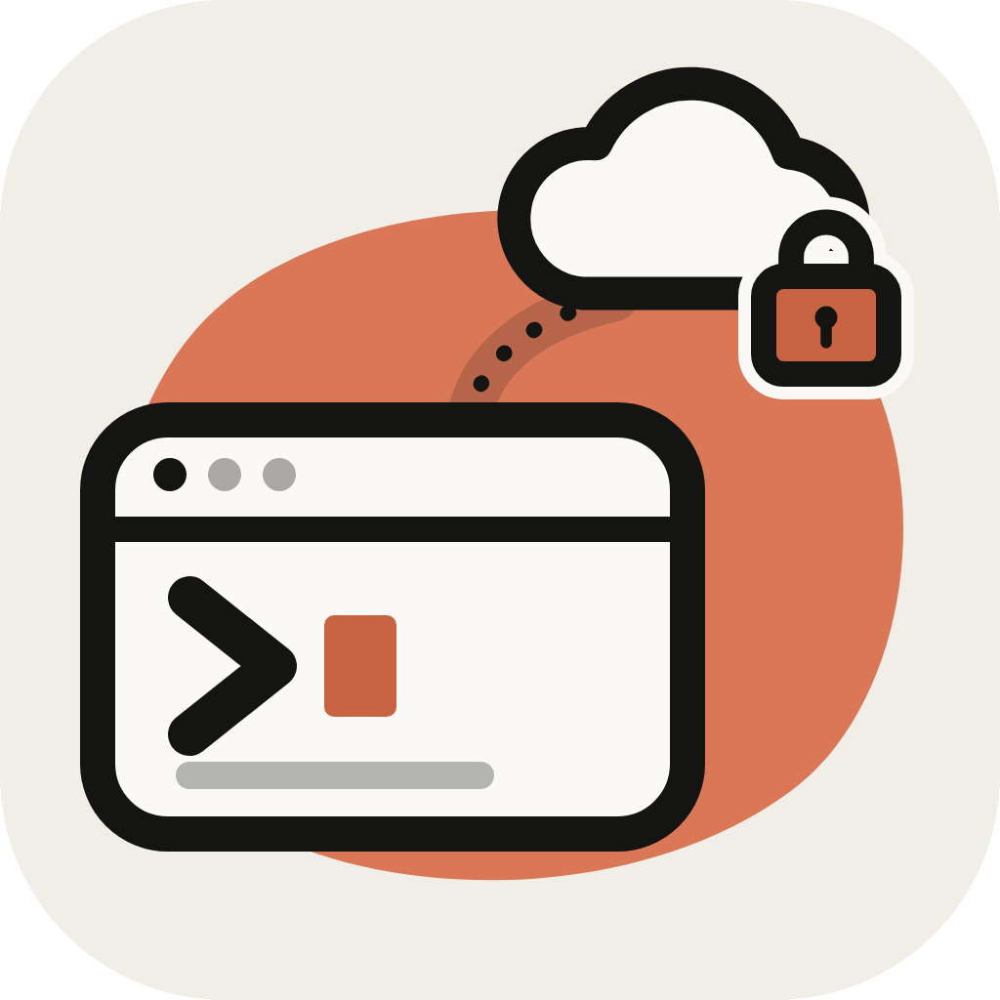
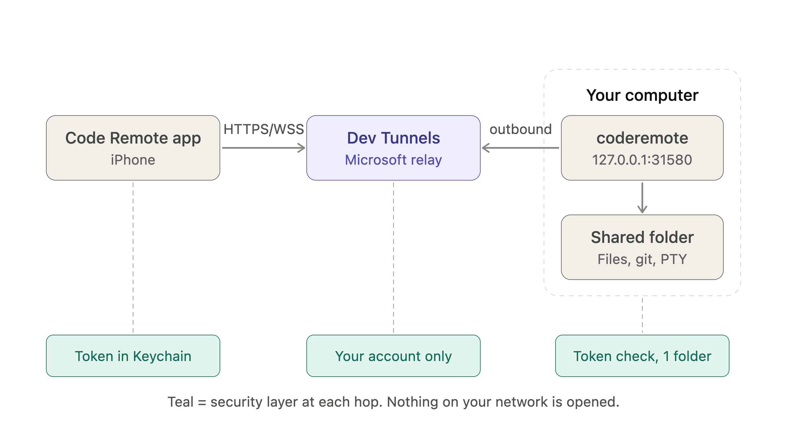

<p align="center">
  
</p>

<h1 align="center">Code Remote</h1>

<p align="center">
  <b>Your computer, in your pocket.</b><br>
  An iPhone app to browse files, use git and run a real terminal on your dev machine,
  over a secure Microsoft Dev Tunnel. No SSH, no port forwarding, no VPN.
</p>

<p align="center">
  <a href="https://www.npmjs.com/package/coderemote"></a>
  <a href="LICENSE"></a>
  
</p>

---

## Get started

On your computer:

```sh
npm install -g coderemote
cd ~/projects/my-app && coderemote up
```

On your iPhone: scan the QR code it prints. That's all: the first run downloads Microsoft's
Dev Tunnels CLI and asks you to sign in with GitHub in the browser.

Want the full editor too? `coderemote up --web` also starts VS Code's own tunnel
(`code tunnel`) and prints a vscode.dev link that opens the folder in VS Code in the browser.
It needs VS Code's `code` command on your `PATH`, signs in with its own GitHub account and
gives the browser the whole machine, not just the shared folder.

The iOS app is coming to the App Store. This repository holds the open-source side: the CLI,
the agent and the wire protocol, so you can audit what runs on your computer or build your own
client.
Everything about the CLI (commands, requirements, FAQ) is in its
[npm README](apps/agent/README.md).

## Features

- **Files:** browse, open, edit, create, rename and delete files in the shared folder
- **Git:** changes and diffs, stage, discard, commit, pull, push and history, across every
  repository in the folder, with a repo picker
- **Terminal:** a real PTY shell with a key bar for Ctrl, Tab, Esc, arrows and modifier
  combos (Mac and Windows layouts); sessions survive the phone sleeping and reattach with
  their output, so `claude`, `vim` or a long build keep going
- **VS Code in the browser (optional):** `coderemote up --web` also starts VS Code's own
  tunnel and prints a vscode.dev link that opens the folder in the full editor
- **Private by default:** only your own GitHub or Microsoft account gets through the tunnel,
  plus a pairing token per device; files and git can't leave the shared folder

## How it works

<p align="center">
  
</p>

The agent listens on `127.0.0.1` and connects out to the relay, so no inbound port is ever
opened. The phone talks to it over HTTPS (files, git) and a WebSocket (terminals). The wire
contract is in [PROTOCOL.md](packages/protocol/PROTOCOL.md); the security model in
[SECURITY.md](SECURITY.md).

## Repository layout

| Path | What it is |
| --- | --- |
| [`apps/agent`](apps/agent) | `coderemote` CLI, published to npm |
| [`packages/agent-core`](packages/agent-core) | the agent: HTTP + WebSocket server for files, git and PTY terminals |
| [`packages/protocol`](packages/protocol) | wire contract shared by agent and app |
| [`openspec`](openspec) | specs and change proposals |

## Develop

```sh
npm install                       # JS workspaces; also builds the CLI bundle
npm test                          # agent end-to-end tests (real HTTP, WebSocket, PTY)
(cd apps/agent && npm link)       # `coderemote` on your PATH, running this checkout
```

After changing agent code, `npm run build -w coderemote` refreshes the linked command.

To run the end-to-end suite against a live agent:

```sh
VSREMOTE_URL=https://… VSREMOTE_TOKEN=… npm test
```

## Contributing

Contributions are welcome: see [CONTRIBUTING.md](CONTRIBUTING.md) and the
[Code of Conduct](CODE_OF_CONDUCT.md). Report vulnerabilities privately as described in
[SECURITY.md](SECURITY.md), not in public issues.

## License

Copyright (C) 2026 Thanh Tran

This program is free software: you can redistribute it and/or modify it under the terms of
the GNU Affero General Public License as published by the Free Software Foundation, either
version 3 of the License, or (at your option) any later version. See [LICENSE](LICENSE).

In short: you may use, study, modify and share it, but if you distribute it, or let people
use a modified version over a network, you must publish your source code under the same
license.

The name "Code Remote" and the app icon are not covered by the AGPL; see
[TRADEMARKS.md](TRADEMARKS.md). A fork you distribute needs its own name and icon.
