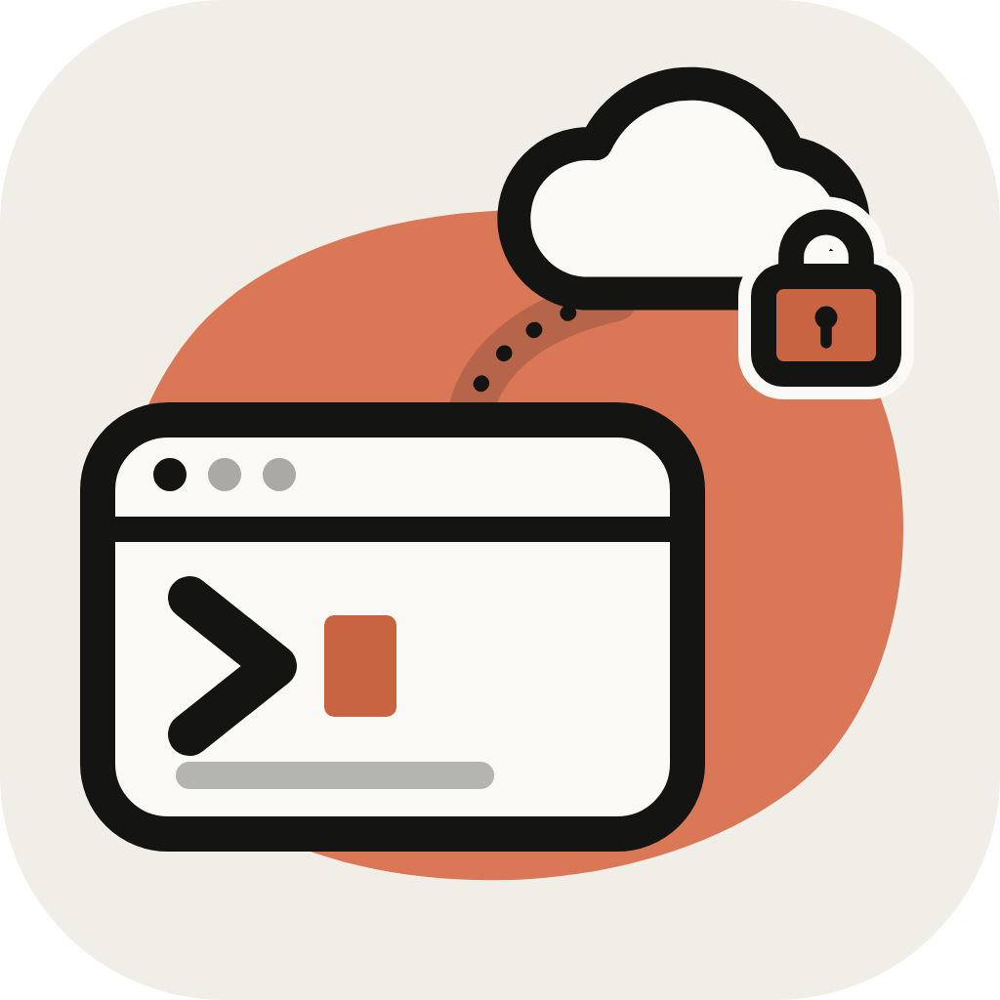

<p align="center">
  
</p>

<h1 align="center">coderemote</h1>

<p align="center">
  <b>Use your computer from your iPhone.</b><br>
  Browse files, review and commit with git, and run a real terminal on your dev machine,
  over a secure Microsoft Dev Tunnel. No SSH keys, no port forwarding, no VPN.
</p>

<p align="center">
  <a href="https://www.npmjs.com/package/coderemote"></a>
  <a href="https://github.com/CodeRemoteApp/coderemote/blob/main/LICENSE"></a>
  
</p>

<p align="center">
  <a href="https://coderemoteapp.github.io/web/"><b>Website</b></a> ·
  <a href="https://coderemoteapp.github.io/web/docs/"><b>Docs</b></a>
</p>

---

`coderemote` is the computer side of **Code Remote**, an iOS app for remote development.
Run one command in a project folder, scan the QR code with your iPhone, and that folder is
in your pocket:

- **Files:** browse, open and edit files in the shared folder, create, rename and delete.
- **Agent chat:** talk to Claude Code and Codex in a proper chat view instead of a raw
  terminal. Follow what the agent is doing and answer its permission prompts and questions
  from your phone.
- **Git:** changes and diffs, stage, commit, pull, push and history, across every repo in the folder.
- **Terminal:** a real shell that keeps running when your phone sleeps, so `vim`, `htop` or a
  long build survive switching apps.
- **Ports:** started a backend or frontend on some local port? The app tunnels that port so you
  can open it on your phone, to test an API or preview a web UI without deploying.
- **VS Code in the browser (optional):** `coderemote up --web`.

## Quick start

```sh
npm install -g coderemote
cd ~/projects/my-app && coderemote up
```

Scan the QR code with your iPhone Camera, or the **+** button in the app. The first run
downloads Microsoft's Dev Tunnels CLI and asks you to sign in with GitHub.

Other ways to install (the scripts download Node.js when you have none):

```sh
brew install coderemoteapp/tap/coderemote                                                      # Homebrew
curl -fsSL https://raw.githubusercontent.com/CodeRemoteApp/coderemote/main/install.sh | sh    # macOS, Linux
```

```powershell
irm https://raw.githubusercontent.com/CodeRemoteApp/coderemote/main/install.ps1 | iex         # Windows
```

## Claude Code and Codex

Run once to let the app follow and answer your agent sessions:

```sh
coderemote setup claude    # Claude Code plugin
coderemote setup codex     # Codex plugin, then trust its hooks once with /hooks in Codex
```

Inside Claude Code you can also run `/plugin install coderemote --marketplace CodeRemoteApp/coderemote`.

## Requirements

- Node.js 22+ on macOS or Windows 10/11 (Linux is expected to work, untested)
- A GitHub or Microsoft account
- The **Code Remote** iOS app (App Store release coming)

Commands, options and details are in the [docs](https://coderemoteapp.github.io/web/docs/).
